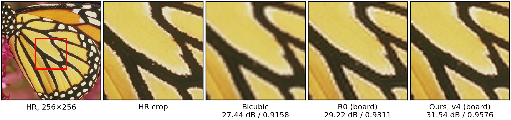
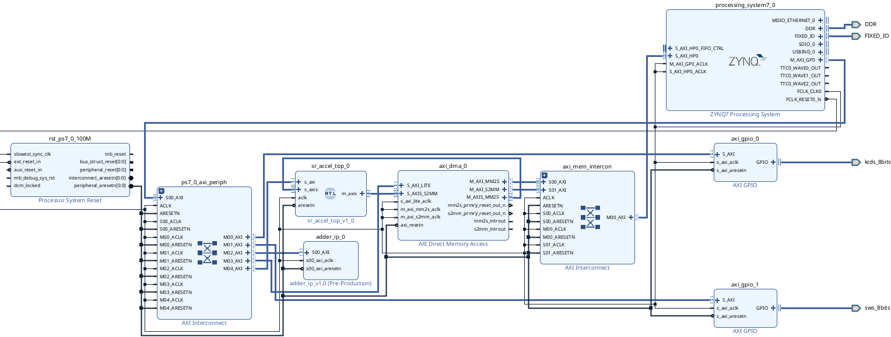
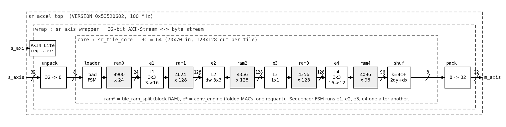
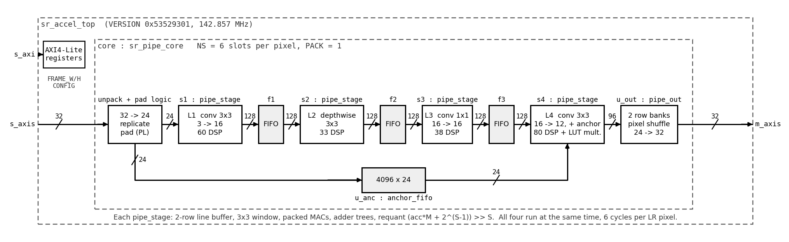
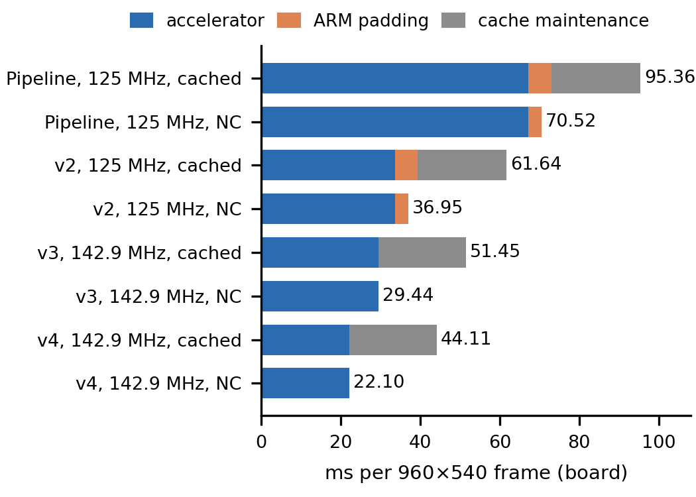

# FPGA Image Super-Resolution Accelerator (ZedBoard / Zynq-7020)

A 2,620-parameter **INT8 CNN** that upscales video frames **2× (960×540 → 1920×1080)**, run by a Verilog accelerator on a **Zynq XC7Z020**
(Digilent ZedBoard, 220 DSP slices). The ARM core drives it through AXI-Lite and AXI DMA. Every hardware output is compared **byte for byte**
with a NumPy integer model of the network.

**Result:** the fastest design (branch [`pipe4`](../../tree/pipe4)) upscales a 960×540 frame in **22.10 ms = 45.2 fps** at 142.9 MHz with 213 DSP
and 24,783 LUT, measured on the board, byte-exact on all 119 images of Set5, Set14 and BSD100. That is 59× the first design (R0, 0.76 fps).
Board power has **not** been measured; the Vivado on-chip estimate for v4 is 3.01 W (simulated activity), i.e. about 67 mJ per frame.



*Set5 butterfly, ×2, 80×80 crop. R0 and v4 are the board outputs; PSNR-Y / SSIM-Y of the whole image
([`make_butterfly_fig.py`](software/analysis/make_butterfly_fig.py)).*

## Designs

Each design is on its own branch with its own bitstream VERSION; a program built for one design refuses to run on another's bitstream.
Frame times are 20-frame means on the board. "NC" = non-cacheable DMA buffers (no ARM cache maintenance), "cached" = the default build.

| Design | Branch | What changed | Clock | DSP / LUT | Cached | NC | fps |
|---|---|---|---|---|---|---|---|
| R0 | `main` | four layer engines run one after another on 64×64 tiles | 100 MHz | 68 / 5,296 | 1,311.7 ms | – | 0.76 |
| Pipeline | [`pipe`](../../tree/pipe) | whole-frame layer pipeline: all four layers work at once, 16 cycles per pixel | 125 MHz | 170 / 9,888 | 95.36 ms | 70.52 ms | 14.2 |
| v2 | [`pipe2`](../../tree/pipe2) | twice the multiplier lanes, 8 cycles per pixel (118 lanes as LUT multipliers) | 125 MHz | 220 / 20,651 | 61.64 ms | 36.95 ms | 27.1 |
| v2 packed | [`pipe2p`](../../tree/pipe2p) | two INT8 products per DSP48E1, no LUT multipliers | 125 MHz | 190 / 13,323 | 61.64 ms | 36.96 ms | 27.1 |
| v3 | [`pipe3`](../../tree/pipe3) | v2 packed + border padding in the logic + 142.9 MHz | 142.9 MHz | 190 / 13,334 | 51.45 ms | 29.44 ms | 34.0 |
| **v4** | [**`pipe4`**](../../tree/pipe4) | **6 cycles per pixel** | 142.9 MHz | 213 / 24,783 | 44.11 ms | **22.10 ms** | **45.2** |

Also on branches (same speed as R0, different weights or clock): `r2q`, `r3q` (100 MHz), `r0_125`, `r3q_125` (125 MHz, 0.94 fps).
Records: [`results/board/2026-11-18/SUMMARY.md`](results/board/2026-11-18/SUMMARY.md) (v3, v4, re-check of all others),
[`2026-11-10`](results/board/2026-11-10/SUMMARY.md) (v2), [`2026-10-28`](results/board/2026-10-28/SUMMARY.md) (pipeline, 125 MHz),
[`docs/STATUS.md`](docs/STATUS.md) (everything, with VERSION values and checksums).

## Architecture

### System (Zynq PS + PL)

The ARM (PS) only configures and moves data; all arithmetic runs in the programmable logic (PL). Vivado block design of the R0 project:



`sr_accel_top_0` is the accelerator (AXI4-Lite `s_axi` at 0x4000_0000, AXI-Stream `s_axis` / `m_axis`). `axi_dma_0` (control at 0x4040_0000) moves
frames between DDR and the accelerator through `S_AXI_HP0` (64 bit). `adder_ip_0` and the two GPIOs are left over from the M0 bring-up.
All designs use this block design ([`design_1_m6.tcl`](hardware/vivado/bd/design_1_m6.tcl)); the pipelines change only the
accelerator RTL and FCLK0, and v3/v4 also widen the DMA memory side to 64 bit.

### One frame, step by step (v4)

1. The ARM checks the accelerator's VERSION register and refuses to run on a bitstream of another design.
2. It writes FRAME_W = 960, FRAME_H = 540 and CONFIG.PAD_EN = 1 (border padding done in the PL).
3. It arms the DMA receive channel (S2MM, 1920×1080×3 bytes), then the send channel (MM2S, 960×540×3 bytes).
4. It writes CONTROL.START. The DMA streams the LR frame in raster order; padding, L1, L2, L3 and L4 all run at the same time.
5. The accelerator streams the HR frame back in raster order, with TLAST on the last beat; the DMA writes it to DDR.
6. The ARM polls STATUS until DONE and reads CYCLES and ERROR_CODE.

R0 does the same per **64×64 tile** instead of per frame: the ARM pads the frame by 3 pixels, cuts 135 tiles of 70×70 (tile + halo),
sends each through the DMA and copies the 128×128 result tile into the HR frame.

### Datapath: R0 (tiled) vs the layer pipeline

RTL hierarchy (`instance : module`, bus widths in bits; drawn by [`make_arch_figs.py`](software/analysis/make_arch_figs.py)).

**R0** (`main`): four `conv_engine`s run one after another on a 64×64 tile, with a block RAM between each pair.



**v4** (`pipe4`): four `pipe_stage`s connected by FIFOs, all running on the same frame at once.



In R0 only one of the four engines works at a time and every engine waits for the whole tile, so 17 % of the 68 DSPs are busy on average.
In the pipeline each stage has a 2-row line buffer, a 3×3 window and its own multipliers; the multiplier count per stage is chosen so all four
stages need the same number of cycles per pixel and no stage waits. Each stage ends in a requantizer `(acc·M + 2^(S-1)) >> S`, clamp to 0..255;
L4 also adds the nearest-neighbour anchor pixel inside the requantizer's rounding constant.

Cycles per input pixel and multipliers per stage:

| Design | Cycles / pixel | L1 conv3×3 3→16 | L2 depthwise 3×3 | L3 conv1×1 16→16 | L4 conv3×3 16→12 | Frame cycles (960×540) |
|---|---|---|---|---|---|---|
| Pipeline | 16 | 27 lanes | 9 | 16 | 108 | 8,398,481 |
| v2 / v2 packed / v3 | 8 | 2× lanes | 2× | 2× | 2× | 4,203,124 / 4,203,125 / 4,205,054 |
| v4 | 6 | 3 channels per slot | 3 per slot | 3 per slot | output-serial, 288 lanes | 3,156,214 |

v4 resources per stage (LUT / DSP): L1 2,436 / 60, L2 1,575 / 33, L3 1,521 / 38, L4 15,227 / 80. Design notes:
[`docs/ARCHITECTURE_PIPELINE.md`](docs/ARCHITECTURE_PIPELINE.md) (pipeline) and `docs/ARCHITECTURE_PIPELINE_V2.md`, `_V2P`, `_V3`, `_V4` on their branches.

### Registers (AXI4-Lite, base 0x4000_0000, pipeline designs)

| Offset | Name | Meaning |
|---|---|---|
| 0x00 | CONTROL | bit0 START, bit1 soft reset |
| 0x04 | STATUS | bit0 BUSY, bit1 DONE (sticky), bit2 ERROR (sticky) |
| 0x08 / 0x18 | FRAME_W / FRAME_H | LR frame size (W ≤ 1018, H ≤ 4096) |
| 0x0C | CYCLES | clock cycles from START to the last output beat |
| 0x10 | ERROR_CODE | 1 early TLAST, 2 missing TLAST, 3 TKEEP ≠ F, 4 frame size out of range |
| 0x14 | VERSION | one value per design, e.g. `0x53529301` = v4 |
| 0x1C | MAX_W | 1018 |
| 0x20 / 0x24 | DBG_IN_BEATS / DBG_OUT_BEATS | stream beats of the current / last frame |
| 0x28 | CONFIG | bit0 PAD_EN (v3, v4): padding in the PL |

R0 keeps TILE_SIZE at 0x08 and debug registers at 0x18-0x30: [`docs/REGISTER_MAP.md`](docs/REGISTER_MAP.md).

### Where the frame time goes



*Board, 960×540 → 1920×1080, 20-frame means ([`frame_breakdown_v4.csv`](results/figures/frame_breakdown_v4.csv)). With non-cacheable (NC)
buffers and padding in the PL, the frame time is the accelerator time (cycles / clock).*

### Details

* **Network:** Conv3×3 (3→16) + ReLU → depthwise 3×3 + ReLU → Conv1×1 (16→16) + ReLU → Conv3×3 (16→12) → pixel shuffle.
  2,560 MACs per input pixel, 1.327 GMAC per frame. uint8 activations, int8 weights, requantizer `(acc·M + 2^(S-1)) >> S`.
  The pipelines use weights trained with quantization-aware training and a nearest-neighbour anchor, which is added inside the
  requantizer's rounding constant at no cost.
* **Layer pipeline:** the frame streams through in raster order; each layer has a line buffer, a 3×3 window and enough multipliers that all
  four layers spend the same number of cycles per pixel, so no layer waits for another ([`docs/ARCHITECTURE_PIPELINE.md`](docs/ARCHITECTURE_PIPELINE.md);
  v2-v4 in `docs/ARCHITECTURE_PIPELINE_V*.md` on their branches). R0 kept only 17 % of its DSPs busy; in the first pipeline every multiplier lane works in every cycle.
* **DSP packing:** two signed weights share one unsigned activation in a DSP48E1, as in *Double MAC* (Nguyen et al., DATE 2017):
  `A = (w2 << 17) + w1`, `P = A·a`, `a·w1 = P[16:0]`, `a·w2 = P[33:17] + P[16]` (checked for all 16.6 M inputs). Unlike Double MAC
  the DSP does not accumulate; the borrow bits go to the adder tree as one extra term.
* **v4 (6 cycles per pixel):** 16 channels do not divide by 6, so layers 1-3 handle 3 channels per slot (two empty slots) and layer 4 switches
  from input-serial to output-serial; 68 packed pairs of layer 4 are built from LUTs because the DSPs run out.
* **Where the time goes:** the accelerator time equals cycles / clock. With cached buffers the ARM spends 22 ms per frame on cache maintenance;
  with non-cacheable buffers and padding in the logic, the frame time is only the accelerator. The ARM then reads the output slowly
  (620 ms instead of 64 ms), so NC suits a display or another DMA master, not software post-processing.
* **Cycle model:** predicted every pipeline frame time before the board run, within 0.7 % ([`docs/paper/cycle_model.md`](docs/paper/cycle_model.md)).

## Verification

`PyTorch FP32` → `NumPy integer model (golden)` → `RTL (Icarus, xsim, netlist)` → `board`. RTL and board are compared byte for byte with the
integer model. v4: full regression 177/177 runs (random weights, stalls, reset pulses, frames at every counter limit), 960×540 frame in xsim
bit-exact, netlist simulation 7/7, mutation test 74 of 79 injected faults caught (the other 5 cannot change the output). Two bugs that normal tests
missed are documented: a FIFO counter that deadlocked only on a full-size frame, and a borrow counter that overflowed only with random weights.

## Quality (PSNR-Y / SSIM-Y, x2; equal to the board output)

| | Set5 | Set14 | BSD100 |
|---|---|---|---|
| Bicubic | 33.67 / 0.9303 | 30.32 / 0.8698 | 29.56 / 0.8434 |
| R0 | 35.02 / 0.9420 | 31.40 / 0.8948 | 30.53 / 0.8756 |
| Pipelines (v1-v4) | 36.20 / 0.9515 | 32.12 / 0.9035 | 31.01 / 0.8833 |

BSD100 images are re-aligned by our LR protocol, so BSD100 values can differ slightly from published ones ([`table_a_x2.md`](results/quality/table_a_x2.md)).

## Comparison with published FPGA SR accelerators

Details and sources: [`docs/paper/RELATED_WORK_TABLE.md`](docs/paper/RELATED_WORK_TABLE.md).

* On the same task (960×540 → 1080p), v4 runs at 45.2 fps with 213 DSP; Liu et al. (TODAES 2024, Kria KV260) report 35.8 fps with 1,210 DSP,
  but with a 40× larger network and 0.94 dB more PSNR on Set5. This is a cheaper design point, not a better design.
* Manabe et al. (FPT 2017) are faster on the same task (60 fps) on a much larger Virtex UltraScale FPGA (339k LUTs, 325 DSPs, luma only).
* Designs on larger devices produce more pixels per second (He et al. FCCM 2018, Chang et al. TCSVT, Kim, Sun: 4-9× our DSPs).
* Per DSP, v4 gives 0.44 output megapixels per second, the highest of the CNN designs compared.
* Kim et al. (TCSVT 2019, 2.56k parameters) and Sun et al. (TCSVT 2021, 2.54k parameters) use networks as small as ours, luma only, and score 0.44 and 0.56 dB more on Set5 at 4K with 1,920 and 1,820 DSPs: our network design leaves quality on the table. Sun et al. report place-and-route results, no board run.
* The layer pipeline (He et al. 2018) and DSP packing (Double MAC, 2017) are known techniques; this project applies them to a 220-DSP device.

## Repository

```
docs/            STATUS.md (all results), REGISTER_MAP.md, VERIFY_YOURSELF.md, DEMO.md, ARCHITECTURE_PIPELINE.md, paper/ (cycle model, comparison, checklists)
software/ai/     dataset, model, training, quantization, integer model, evaluation (Python)
software/board/  ARM bare-metal driver and tests (sr_app/), xsdb/Python board scripts
software/analysis/  cycle model, figures
hardware/rtl/    Verilog (R0 tile engine on main; pipelines on their branches), exported weights
hardware/verification/  testbenches, run_tests.sh, run_postsynth.sh
hardware/vivado/ build scripts, block design (Tcl)
results/         measured numbers: board/ (per session), quality/, utilization/, power_estimate/, figures/
data/            datasets and board files (git-ignored, see data/README.md)
```

**Run it.** Python checks and RTL simulation need no Xilinx tools:

```bash
python3 -m venv --system-site-packages .venv && .venv/bin/pip install -r requirements.txt
.venv/bin/python software/ai/quantization/test_integer.py        # integer model tests
hardware/verification/run_tests.sh quick                           # RTL regression (Icarus Verilog 12)
```

Building the bitstream, the ARM programs and running on the board (Vivado/Vitis 2024.1, tested from a clean clone for R0):
[`docs/VERIFY_YOURSELF.md`](docs/VERIFY_YOURSELF.md), [`software/board/README.md`](software/board/README.md),
[`results/utilization/m7_clean_clone_build.md`](results/utilization/m7_clean_clone_build.md). For a pipeline design, `git checkout pipe4` first.

## Limitations

* 45.2 fps needs non-cacheable buffers; with the default cached buffers v4 runs at 22.7 fps (44.11 ms).
* Power is a Vivado on-chip estimate only (v4: 3.01 W with switching activity from a simulation of the routed netlist, 3.06 W vectorless; [`results/power_estimate/SUMMARY.md`](results/power_estimate/SUMMARY.md)); board power was not measured.
* v4 meets timing with only 0.038 ns of setup slack. All measurements come from one board, one temperature range (≤ 51 °C) and one timing image.
* Frames are loaded over JTAG, not from a camera or video input.
* Image quality is 0.4-0.9 dB (Set5) below the best published designs, including two networks of the same size (Kim et al. 2019, Sun et al. 2021); fine random texture is not recovered.
* Two single first-tile failures of R0 on 2026-10-11 remain unexplained ([`results/speed/m6_board.md`](results/speed/m6_board.md)).

## References

* C. Dong et al., "Accelerating the Super-Resolution Convolutional Neural Network" (FSRCNN), ECCV 2016.
* Z. He et al., "FPGA-Based Real-Time Super-Resolution System for Ultra High Definition Videos", FCCM 2018.
* H. Liu et al., "A High-Performance Accelerator for Real-Time Super-Resolution on Edge FPGAs", ACM TODAES 29(3), 2024.
* J.-W. Chang, K.-W. Kang, S.-J. Kang, "An Energy-Efficient FPGA-Based Deconvolutional Neural Networks Accelerator for Single Image Super-Resolution", IEEE TCSVT.
* T. Manabe, Y. Shibata, K. Oguri, "FPGA Implementation of a Real-Time Super-Resolution System with a CNN Based on a Residue Number System", FPT 2017.
* Y. Kim, J.-S. Choi, M. Kim, "A Real-Time Convolutional Neural Network for Super-Resolution on FPGA with Applications to 4K UHD 60 fps Video Services", IEEE TCSVT 29(8), 2019.
* S. Lee, D. Kim, D. Nguyen, J. Lee, "Double MAC on a DSP: Boosting the Performance of Convolutional Neural Networks on FPGAs", IEEE TCAD 38(5), 2019.
* K. Sun, M. Koch, Z. Wang, S. Jovanovic, H. Rabah, S. Simon, "An FPGA-Based Residual Recurrent Neural Network for Real-Time Video Super-Resolution", IEEE TCSVT 32(4), 2021.
* D. Nguyen, D. Kim, J. Lee, "Double MAC: Doubling the Performance of Convolutional Neural Networks on Modern FPGAs", DATE 2017.
* O. Ahmed et al., "Super-Resolution CNN Accelerator on Low-Cost Zynq-7000 Series SoC-based FPGA", URSI 2024.
* G. Joseph, E. P. Jayakumar, "Quantized Neural Network Architecture for Hardware Efficient Real-Time 4K Image Super-Resolution", VDAT 2024.
